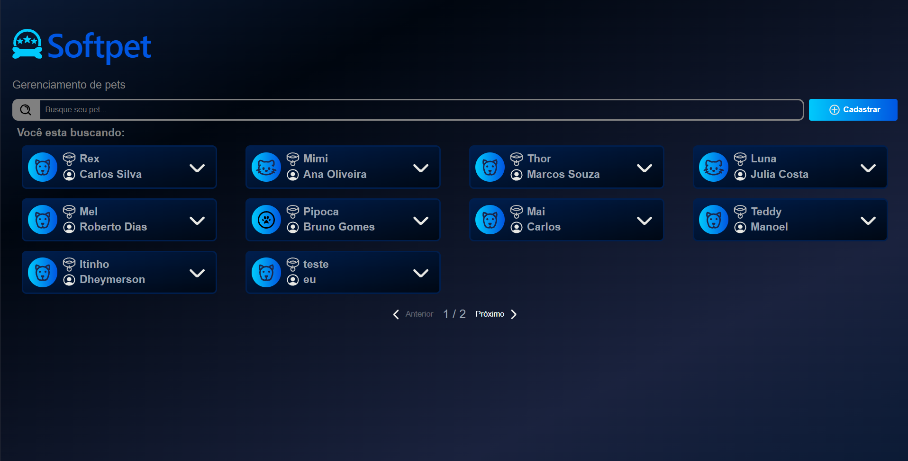

# SoftPet 🐾

Sistema de gerenciamento de pets desenvolvido com React e Vite, como parte do desafio Dev Jr. da SoftMakers.

## Preview

<!-- ADICIONE AQUI UMA CAPTURA DE TELA DO PROJETO -->



**Deploy:** [Acessar SoftPet]()

**Desafio original:** [SoftMakers Challenges](https://github.com/BrSoftMakers/desafio-junior-1)

## Funcionalidades

- Cadastro de pets.
- Edição e exclusão de registros.
- Busca por nome, espécie e tutor.
- Paginação adaptável ao tamanho da tela.
- Visualização de detalhes dos pets.
- Persistência dos dados utilizando LocalStorage.
- Interface responsiva.

## Tecnologias

- React
- JavaScript
- CSS
- Vite
- LocalStorage

## Como executar

Clone o repositório:

```bash
git clone https://github.com/Jore-X/softpet-petshop
```

Entre na pasta:

```bash
cd softpet-petshop
```

Instale as dependências:

```bash
npm install
```

Inicie o servidor:

```bash
npm run dev
```

## Armazenamento

Os dados são armazenados localmente no navegador por meio do LocalStorage. Cada usuário possui seus próprios registros no dispositivo utilizado.

## Autor

Desenvolvido como projeto de prática e aprendizado em desenvolvimento front-end.

**GitHub:** [Seu perfil](https://github.com/Jore-X)
**Portfólio:** [Meu portfólio](https://jorecode.netlify.app/)
